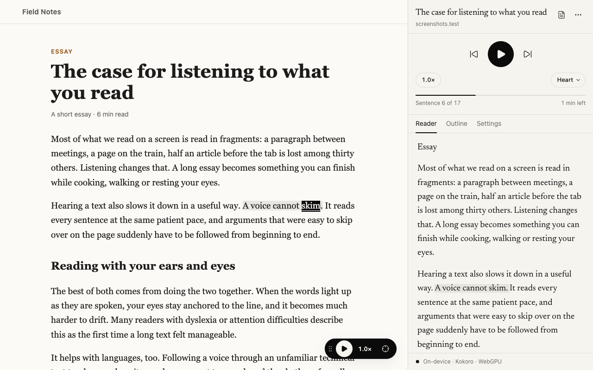
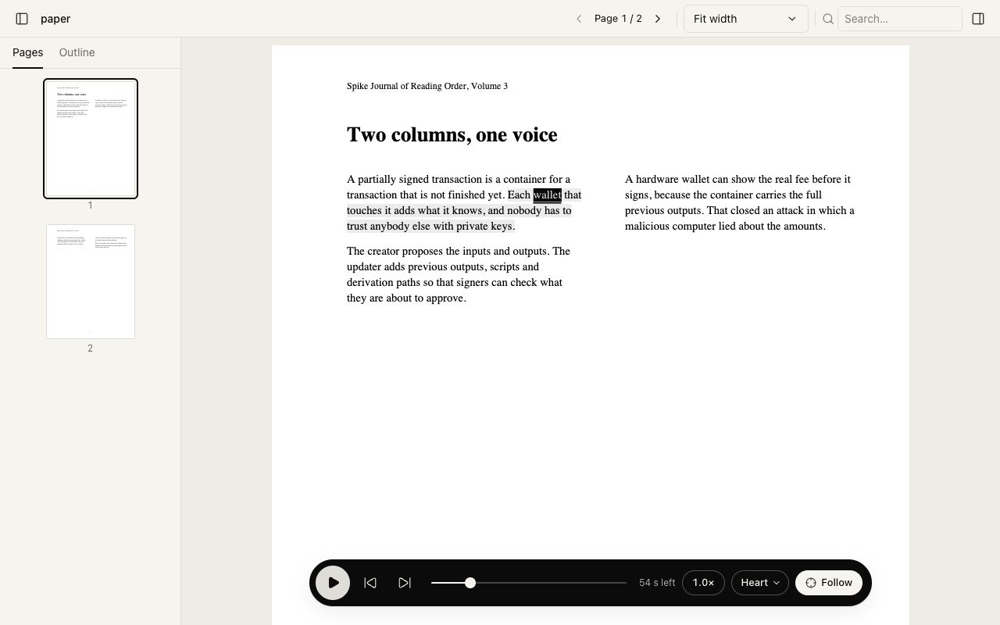

# Open Reader

**Listen to any article or PDF in a natural voice, with every word highlighted as it's spoken.
Free, private, and it works offline.**

Open Reader is a read-aloud extension for Google Chrome. Click its icon on an article, press
**Read this page**, and sit back. The voice runs on your own computer, so nothing you read is sent
anywhere, and it keeps working on a plane or without Wi-Fi.

## Why Open Reader

- **Natural voices, on your device.** Open Reader uses modern neural voices that sound like a
  person reading, not a robot. They run inside Chrome on your computer.
- **Follow along word by word.** The sentence being read is shaded and the current word is
  highlighted, both on the page and in the side panel. The page scrolls with the voice, so your
  place is never lost.
- **Articles and PDFs.** It finds the main text of a web page and skips menus, ads and footers. In
  PDFs it handles two-column layouts and leaves out running headers, page numbers and references.
  Scanned PDFs are recognized on your computer.
- **Private by design.** No account, no tracking, no analytics. The only download is the voice
  itself, once.
- **Free.** No subscription and no word limits.

## Install

<!-- CHROME_WEB_STORE_LINK: replace this block with the listing URL once published. -->

**Chrome Web Store:** coming soon.

You need Chrome 116 or later on a desktop computer (Windows, macOS, Linux or ChromeOS).

After installing, pin Open Reader from Chrome's puzzle-piece menu so its icon is always in
the toolbar.

## Getting started

A welcome page opens right after you install. It:

1. **Downloads the voice** (about 330 MB, or about 90 MB on computers without a capable graphics
   chip). This happens once; after that Open Reader works offline.
2. **Checks how fast your computer is** and suggests a lighter voice if it would be smoother.
3. **Lets you pick a voice** and shows the three shortcuts worth remembering.

Until the download finishes, Open Reader reads with your computer's built-in voices, so you can
start right away.

## How to use it

### Listen to a web page

Open an article and click the Open Reader icon. The side panel opens; press **Read this page**.

Other ways to start:

- Press **Alt+Shift+P** on any page.
- Right-click the Open Reader icon and choose **Read this page**.
- Right-click a paragraph and choose **Read page from here**.
- Select some text and press **Play from here**, or choose **Read selection aloud**.

A small floating player appears on the page while it reads. The side panel always follows the
tab in front of you: switch to another article and press **Read this page** to hear that one
instead. Whatever is still playing elsewhere stays in a bar at the top, with **Go to tab**.

### Listen to a PDF

- **A PDF open in a tab:** the side panel offers **Read this PDF**.
- **A PDF on your computer:** press the PDF button at the top of the side panel (or **Open a PDF
  from your computer**), then choose the file or drop it onto the page.

The PDF opens in Open Reader's own reader, with page thumbnails, an outline, search and zoom. To
open PDFs stored on your computer from a `file://` link, go to `chrome://extensions`, open Open
Reader's **Details**, and turn on **Allow access to file URLs**.

### While it reads

- **Jump around:** click any sentence in the side panel, or Alt+click a word on the page.
- **Change the speed:** from 0.5× to 4×, without the voice getting squeaky.
- **Change the voice:** pick another one from the voice menu at any time.
- **Pick up where you left off:** the side panel's **Recent** list reopens an article at your
  position, or a PDF from its saved copy.
- **Set a sleep timer:** side panel → **Settings**. Stop after a number of minutes or at the end
  of the section; it always finishes the sentence first.
- **Skip parts you don't want read:** code blocks, tables, citations, web addresses and reference
  lists are skipped by default. Change this for one page in **Settings**, or for everything in Options →
  Reading rules.

### Make an audiobook

Side panel → **Settings** → **Export audiobook…** (or **Reading options** in the PDF reader).
Open Reader saves the whole document to your Downloads folder as an MP3 with a chapter for every
heading, or as a WAV file.

### Teach it a word

If a name or term is mispronounced, go to Options → **Pronunciations**, add the word with how it
should sound, and press **Test** to hear it. You can import and export your list.

## Keyboard shortcuts

| Action                              | Keys                      |
| ----------------------------------- | ------------------------- |
| Open the side panel                 | Alt+Shift+O               |
| Play or pause (anywhere)            | Alt+Shift+P               |
| Next / previous sentence (anywhere) | Alt+Shift+. / Alt+Shift+, |
| Play or pause                       | Space                     |
| Previous / next sentence            | J / K                     |
| Previous / next paragraph           | Shift+J / Shift+K         |
| Slower / faster                     | − / =                     |
| Follow the voice on or off          | F                         |
| Stop                                | Esc                       |

The first three work in any tab, and you can change them at `chrome://extensions/shortcuts`. The
rest work on the page being read, in the side panel and in the PDF reader.

## Voices

| Voice                                    | Sounds like                     | Best for                                          |
| ---------------------------------------- | ------------------------------- | ------------------------------------------------- |
| **Kokoro**: Heart, Michael, Emma, George | Natural American and British    | Most computers; the default                       |
| **Piper**: Classic, Medium, LJSpeech     | Clear and steady                | Older or slower computers                         |
| **System voices**                        | Your computer's built-in voices | Before a voice is downloaded, or as a last resort |

Add or remove voices in Options → **Voices & models**, where **Run benchmark** tells you which one
runs best on your computer. If a voice ever fails, Open Reader switches to the next one by itself
and tells you.

## Privacy

Open Reader collects nothing. Everything you read, your reading history and your settings stay
in your Chrome profile.

It goes online only when you ask it to: to download a voice (from Hugging Face, with every file
checked against a known fingerprint), or to fetch a PDF you open from a link. Chrome's own online
voices, which send text to Google, are hidden unless you turn off **Strict offline** in Options.

Open Reader needs permission to read the pages you visit so it can find the text and highlight it
when you press **Read this page**. It does nothing on a page until you ask it to read. The full
details are in [docs/PRIVACY.md](docs/PRIVACY.md).

## Troubleshooting

| What you see                                     | What to do                                                                                                                          |
| ------------------------------------------------ | ----------------------------------------------------------------------------------------------------------------------------------- |
| "This page can't be read aloud"                  | Chrome doesn't let extensions read its own pages (`chrome://…`) or the Web Store. For a PDF, use **Open a PDF from your computer**. |
| "No readable text was found"                     | Some pages draw their text in an unusual way. Select the text and choose **Read selection aloud**.                                  |
| A PDF on your computer won't open                | Turn on **Allow access to file URLs** in Open Reader's **Details** at `chrome://extensions`.                                        |
| The voice pauses between sentences               | Options → Voices & models → **Run benchmark**, then choose the voice it recommends. A notice suggests this when it notices delays.  |
| "Switched to … because … failed"                 | That voice couldn't run on your computer, so the next one took over. Nothing to do unless you prefer another voice.                 |
| No sound                                         | Check that the tab isn't muted and that your computer's sound output is right.                                                      |
| Highlights are off on a page that changes itself | Some pages rebuild themselves while you read. Reading continues in the side panel; press **Read this page** again to re-attach.     |
| Storage is getting full                          | Options → Storage: lower the audio cache limit, clear it, or remove stored PDFs.                                                    |

Still stuck? Open Options → **Diagnostics** → **Copy diagnostics** and include the report when
you [open an issue](../../issues). The report never contains what you were reading, page titles
or addresses.

## Contributing

Bug reports, ideas and pull requests are welcome. [CONTRIBUTING.md](CONTRIBUTING.md) explains how
to build Open Reader from source, how it is put together, and how to run the tests.

## Thanks

Open Reader stands on the work of [Kokoro](https://huggingface.co/hexgrad/Kokoro-82M) and
[Piper](https://github.com/rhasspy/piper) (voices), [ONNX Runtime](https://onnxruntime.ai/)
(running them), [PDF.js](https://mozilla.github.io/pdf.js/) (PDFs),
[Tesseract](https://github.com/naptha/tesseract.js) (scanned pages) and
[Readability](https://github.com/mozilla/readability) (finding the article). Their licenses are
listed in [docs/THIRD_PARTY.md](docs/THIRD_PARTY.md) and [docs/MODELS.md](docs/MODELS.md).
